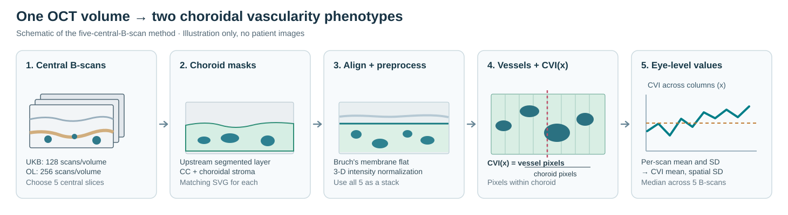

# ChoroX: OCT-derived choroidal vascularity extraction

Python code for extracting choroidal vascularity index (CVI) phenotypes from macular optical coherence tomography (OCT). The code accompanies research on the genetic architecture of choroidal vascularity in the **UK Biobank**, with external evaluation in **OphtalmoLaus**.

**What you provide:** one OCT volume exported as ordered grayscale B-scans, together with matching SVG choroid-layer masks. **What you obtain:** CVI mean and CVI spatial variability for that volume, plus an optional vessel-area measurement. A reproducible synthetic example is included; no clinical images or participant-level data are distributed.



<sub>Schematic of the extraction described in the manuscript (Fig. 3). The choroidal layer masks are inputs to this repository; the upstream AI-based retinal layer segmentation model is not included. Diagram is illustrative, not clinical imaging.</sub>

## Quick start: Conda or Mamba

Run these commands in the repository root. On Windows, **Anaconda Prompt** is the simplest option; Git Bash and PowerShell also work when Conda/Mamba shell initialization is configured.

```bash
# Choose ONE environment creation command:
mamba env create -f environment.yml
# or: conda env create -f environment.yml
# or: micromamba create -f environment.yml

conda activate choroid-cvi
python -m pip install --no-build-isolation --no-deps -e .

# Try the complete five-B-scan synthetic example:
python examples/run_single_volume.py

# Check the calculations and input validation:
python -m unittest discover -s tests -v
```

The environment uses Python 3.11 and Conda-forge for the scientific and SVG-rendering dependencies, including Cairo. `python -m pip install --no-build-isolation --no-deps -e .` registers this repository's importable package and `choroid-cvi` command without fetching dependencies from PyPI. If you used Micromamba instead of Conda, run `micromamba activate choroid-cvi` after initializing its shell.

If `conda activate` is not recognized in Git Bash, run `conda init bash` once and reopen Git Bash, or use Anaconda Prompt.

The synthetic run loads five generated grayscale images, five SVG masks and an `info.json` file. You can recreate these files at any time with `python examples/make_synthetic_example.py`. They are designed to demonstrate I/O, not to represent real choroidal morphology or establish clinical accuracy.

## Use on one OCT volume

Each OCT volume is treated independently. The method selects the **five central B-scans**; a single B-scan alone does not reproduce the eye-level phenotypes in the manuscript.

For an exported folder with the documented naming convention:

```text
my_study/
  oct_volume/
    info.json
    0000.jpg
    0001.jpg
    ...           # all B-scans in acquisition order
  svg_segmentation/
    0000.svg
    0001.svg
    ...           # one matching mask per B-scan
```

```bash
choroid-cvi --cube-dir my_study/oct_volume \
            --seg-dir my_study/svg_segmentation \
            --sample-id example_001 \
            --output results/phenotypes.csv
```

Or call the array-based Python interface directly, after loading five aligned grayscale B-scans and their corresponding parsed SVG segmentations:

```python
from choroid_cvi import extract_cvi

result = extract_cvi(
    oct_bscans,              # five ordered 2-D grayscale arrays
    choroid_segmentations,  # five corresponding parsed SVG XML elements
    spacings=scan_spacing,  # optional, needed for vessel area in mm²
)
print(result.cvi_mean)
print(result.cvi_spatial_sd)
```

For a complete working Python script, see [examples/run_single_volume.py](examples/run_single_volume.py).

### Input requirements

- The source export contains consecutively numbered `0000.jpg`, `0001.jpg`, … images in B-scan acquisition order, and SVG masks with the same stems.
- Each SVG identifies the choroid region with the class `layer layer-6` (`CC_CS`).
- The selected five B-scans must have identical image dimensions and grayscale intensity.
- `info.json` includes `"spacing": [...]` with the physical pixel spacings in **mm/pixel** at indices 2 and 3 for the optional area calculation. The folder-based CLI expects this file.
- The preprocessing uses a fixed Bruch's-membrane alignment target and crop window; scan geometry and segmentation quality should be checked before applying it to a new OCT device.
- This repository processes exported B-scans and existing masks. Generation of the choroid masks by an upstream AI segmentation model, and study-level quality control, are separate steps.

In the manuscript, the UK Biobank acquisition contains 128 B-scans per OCT volume; the OphtalmoLaus acquisition contains 256. The algorithm reduces either volume to its five central B-scans. Device-specific vessel-segmentation thresholds can be supplied with `--parameters`; see [example parameters](examples/segmentation_parameters.example.json).

## Compute phenotypes

After Bruch's membrane alignment, three-dimensional denoising and depth-intensity normalization, the pipeline combines large- and smaller-vessel masks obtained through adaptive thresholding and morphological processing.

For B-scan `j` and lateral column `x`:

$$
\mathrm{CVI}_j(x)=\frac{\text{segmented vessel pixels in column }x}{\text{choroid-mask pixels in column }x}.
$$

Within each B-scan, compute the mean and population standard deviation of these column-wise values. The two volume-level phenotypes are the **medians of those five per-B-scan summaries**:

$$
\mathrm{CVI}_{\mathrm{mean}}=\operatorname{median}_j\bigl(\operatorname{mean}_x\mathrm{CVI}_j(x)\bigr)
$$

$$
\mathrm{CVI}_{\mathrm{spatial\ variability}}=\operatorname{median}_j\bigl(\operatorname{SD}_x\mathrm{CVI}_j(x)\bigr).
$$

The second phenotype measures *lateral heterogeneity within a B-scan*, not the standard deviation over an entire pooled OCT volume. In the implementation, columns with no choroid-mask pixels are assigned CVI = 0 before the mean and SD are calculated; this assumption is documented for reproducibility.

The optional `pachy_area_mm2` output estimates the median area of the largest connected segmented vessel region per B-scan, using the OCT image pixel spacings. It is not a GWAS outcome described in this repository.

Full method details and acquisition assumptions: [docs/methods_and_assumptions.md](docs/methods_and_assumptions.md).

## Process a dataset

Users can independently loop over OCT studies, or provide a manifest CSV with columns `sample_id,cube_dir,seg_dir`. See [examples/manifest.example.csv](examples/manifest.example.csv):

```bash
choroid-cvi --manifest examples/manifest.example.csv \
            --parameters examples/segmentation_parameters.example.json \
            --output results/phenotypes.csv
```

Each output row contains `sample_id`, `n_bscans`, `cvi_mean`, `cvi_spatial_sd`, `pachy_area_mm2`, `status`, and `error`. A neighboring `.run.json` file records the execution time, dependencies, and segmentation settings. Processing continues past a failed study, marking that row as an error; the command returns a nonzero exit code if any study failed.

The manifest and batch CLI are conveniences, not requirements for integrating the core method in another imaging pipeline.

## Relationship to the GWAS

The extraction outputs form the imaging phenotypes for downstream genetic analysis. The paper additionally analyzes phenotype quality control and transformation, BGENIE GWAS, LD clumping, SNP heritability and genetic correlation, gene/pathway enrichment, regulatory mapping, Mendelian randomization, and external genetic replication.

**This repository currently implements OCT-to-phenotype extraction.** It does not purport to run those genetic analyses. The [GWAS reproducibility inventory](docs/gwas_reproducibility.md) lists the analysis scripts, settings, and data schemas needed to make the full study independently reproducible. Standard tools such as BGENIE, PLINK2, and LDSC need not be copied into the repository; exact versioned commands and custom analysis code should be supplied.

## Data, citation, and release

- UK Biobank and OphtalmoLaus participant-level OCT/genetic data are subject to their respective access and governance conditions. Do not commit real OCT images, masks, participant identifiers, individual phenotypes, or credentials to public GitHub.
- An openly distributable synthetic example is included for execution and interface testing.
- The manuscript's source-access and summary-statistics availability statements should be consulted for the GWAS resources.
- The project's software license and definitive citation metadata must be approved and completed before public release. [`CITATION.cff.example`](CITATION.cff.example) contains a template, not final bibliographic metadata.

See the [release checklist](docs/reproducibility_checklist.md) for validation and publication steps.
